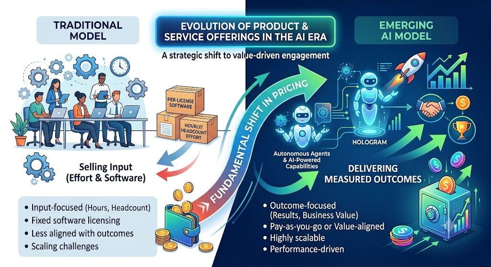

# Chargebee Staff PM Interview — Case Study

## Context

You are stepping into the role of a Product Owner at Chargebee, tasked with driving the company's Billing initiative that includes the subscriptions & invoices module primarily. You bring with you some knowledge of the billing / SaaS space, and your mandate is to reimagine how Chargebee's billing platform can fit into the billing use cases of the new age AI companies like Replit, Replika, Mistral, etc. and at the same time serve existing businesses.

## Problem Statement

Chargebee is exploring how to reimagine its billing platform to serve the diverse billing use cases of AI-native companies and SaaS companies (who are undergoing AI transformation). As a product leader, you need to:

1. Create ICP segments that Chargebee will serve in the AI & SaaS space
2. Create a table mapping ICP segment → billing needs → preferred billing model.
3. Identify the gaps in the current subscription model of Chargebee by going through the API & user docs of Chargebee
4. Explore how these problems are solved by competition?
5. Develop a prioritized roadmap for delivering these capabilities.
6. Showcase value that this roadmap brings to drive organizational buy-in.
7. Guide the team on how they can start building these capabilities (by taking any one of the capabilities)

## Guidelines

- You can explore the pricing pages of AI and SaaS companies or contract terms mentioned in T&Cs to understand their pricing and billing strategy
- You may leverage AI tools available in the market to study competition and the solutions available in the market
- You can use Chargebee's public documentation on features & APIs to understand Chargebee's subscription / billing models
- You can consider AI-based features to solve some of the gaps if needed.
- Platform mind set, creativity, clarity, and practicality will be evaluated.
- The output format is flexible (document, slides, or Lovable link or a combination of any of these).

---

## Changing Paradigm

### Evolution of Offerings and the Shift in Pricing Models

**What is changing in the product landscape**

1. **From selling inputs to selling outcomes.** Software and services used to be priced on effort (licences, hours, headcount). AI products increasingly deliver the finished work, so price moves toward the result (a resolved ticket, a qualified lead).
2. **Seats stop tracking value.** When agents do the work, the number of human users says little about what the customer gets. Pricing units shift to credits, runtime, tasks and outcomes.
3. **Cost now scales with use.** Every AI call costs real compute, unlike traditional software where extra use was nearly free. Pricing has to protect margin as well as capture value.
4. **Hybrid models are the reality.** Few companies are fully usage- or outcome-based. Most combine a base subscription, a pooled credit allowance and pay-as-you-go overage.
5. **Pricing becomes continuous.** Models, costs and customer behaviour change quickly, so pricing is revised often, not once a year. Billing has to make those changes cheap and safe.

---

## 1. ICP Segments

Seven segments, chosen so each represents a genuinely different **billing mechanic** — not just a different vertical. This is deliberate: the point of segmenting this way is that each segment will demand a different capability from Chargebee's platform (task 2 maps this out as a table).

| # | Segment | Examples | Billing Shape | Why Distinct |
|---|---------|----------|---------------|---------------|
| 1 | **AI Coding / Dev Tool Platforms** | Replit, Cursor | Seat tiers (Replit Core $20/mo, Pro $100/mo; Cursor Pro $20/mo, Pro+ $60/mo, Ultra $200/mo) bundled with a **pooled monthly usage credit** for agent/compute consumption, with pay-as-you-go overage once the pool is exhausted. | Hybrid seat+usage where the usage pool is *sized to the seat tier* — overage billing has to reconcile against a plan-specific allowance, not a flat rate. |
| 2 | **Consumer AI Companion / Chat Apps** | Replika, Character.AI | Flat consumer subscription (Character.AI c.ai+ at $9.99/mo or $94.99/yr) plus an **in-app virtual currency** (Replika's Coins & Gems, purchasable; Character.AI's Charms, currently earn-only but purchasing is planned) for cosmetic/feature unlocks. | High-volume, low-ACV consumer billing — dunning, involuntary-churn recovery, and card-decline handling matter more than metering precision; virtual-currency micro-transactions are a second, emerging revenue lever. |
| 3 | **Foundation Model / API Providers** | OpenAI, Mistral AI | Pure per-token metering drawn down against a prepaid credit balance (min. $5 top-up, credits expire), with custom-quoted enterprise contracts (committed spend, volume discounts) layered on top for large accounts. | Metering has to operate at extreme volume and granularity (billions of events/day, sub-cent unit economics) with real-time balance enforcement — a materially different scale problem than seat billing. |
| 4 | **Outcome-Based AI Platforms** | Intercom Fin | Billed **per resolved outcome**, not per token or seat — Fin charges $0.99 per resolution (or event-specific rates like $9.99 per qualified lead), with a $49/mo plan bundling 50 resolutions. | The billable unit is a *business outcome* defined by the customer's own product logic, not a platform-observable usage event — Chargebee would need to ingest an external "outcome" signal rather than meter usage itself. |
| 5 | **Vertical Enterprise AI-Native** (High-ACV, Quote-Based) | Harvey (legal AI) | No public pricing at all — pure enterprise sales-quoted, seat-based licensing with 20-50 seat minimums and 12-month terms (third-party estimates put per-seat pricing at $100-2,400/mo depending on bundle). | Billing is essentially a contract-management problem, not a metering problem — the platform needs to support negotiated multi-year quotes, minimum commitments, and custom invoicing rather than self-serve plans. |
| 6 | **Traditional Seat-Based SaaS Layering In AI** | Notion AI, Salesforce Einstein / Agentforce | AI capability is gated into an existing seat tier (Notion bundles full AI only into its $20/member/mo Business plan) and/or sold as a metered add-on on top of seat contracts (Notion's Custom Agents at $10/1,000 credits; Salesforce's Einstein/Agentforce add-ons at $50-125/user/mo plus "Flex Credits" pools at $500/100K credits). | Billing must **coexist with a legacy seat contract** already on the books — the challenge isn't inventing a new model, it's layering a consumption or add-on charge onto an existing subscription without disrupting the base contract or renewal cycle. |
| 7 | **AI Infrastructure / Inference & Compute Providers** | CoreWeave, Together AI, Fireworks AI | On-demand per GPU-hour (CoreWeave H100 from about $6.16/GPU-hr), reserved contracts discounted up to about 60%, spot up to about 60% below on-demand; Together AI sells per-token serverless plus dedicated endpoints and hourly GPU rates; Fireworks sells per-token serverless plus Provisioned Throughput Units. *(Figures from third-party comparisons, not vendor pricing pages.)* | The billable commitment is reserved or provisioned capacity with on-demand burst on top — billing must reconcile committed vs. burst usage across mixed units (GPU-hours, tokens, throughput units). Segment 3 is pure token drawdown; this adds the capacity-commitment mechanic. |

**Sources:** [Replit AI billing docs](https://docs.replit.com/billing/ai-billing) · [Cursor pricing breakdown](https://www.eesel.ai/blog/cursor-pricing) · [Replika Coins & Gems](https://help.replika.com/hc/en-us/articles/4422854870541-Gems-Coins) · [Character.AI pricing](https://www.eesel.ai/blog/character-ai-pricing) · [OpenAI Enterprise token-based pricing](https://help.openai.com/en/articles/20001415-chatgpt-rate-card-enterprise-token-based-pricing) · [Mistral API pricing](https://www.cloudzero.com/blog/mistral-api-pricing/) · [Fin pricing & outcomes](https://fin.ai/help/en/articles/13975800-fin-pricing-outcomes) · [Harvey AI pricing analysis](https://www.eesel.ai/blog/harvey-ai-pricing) · [Notion AI pricing changes](https://flowith.io/blog/notion-ai-pricing-10-month-addon-worth-it/) · [Salesforce AI pricing](https://www.amio.io/blog/salesforce-ai-pricing-seats-credits-add-ons-explained) · [CoreWeave pricing model](https://www.datacenterknowledge.com/cloud/coreweave-s-flexible-pricing-bet-signals-strategic-shift) · [CoreWeave vs Together AI](https://metavert.io/coreweave-vs-together-ai) · [CoreWeave vs Fireworks AI](https://metavert.io/compare/coreweave-vs-fireworks-ai) · [Metronome: provisioned throughput billing](https://docs.metronome.com/guides/pricing-packaging/billing-model-guides/provisioned-throughput.md)

---

## 2. Billing Needs & Preferred Model by Segment

Each segment's billing-perspective **goal** — what it's fundamentally optimizing for — drives its billing needs and preferred model.

### 1. AI Coding / Dev Tool Platforms

- **Goal:**
  - Provide an AI-assisted coding / dev environment (agent-driven code generation, compute-heavy).
  - Keep the entry seat price low and predictable, while converting heavy agent/compute usage into overage revenue instead of forcing an abrupt plan upgrade.
- **Key Billing Needs:**
  - Multiple seat tiers, each with a different usage allowance
  - Monthly-resetting usage-credit pool sized per tier
  - Real-time metering against that pool with depletion alerts
  - Overage billed only after the tier's pool is exhausted, at a rate/logic tied to that specific tier (not a flat global rate)
  - Pro-rated re-scoping of the usage pool on mid-cycle tier upgrade/downgrade
- **Preferred Billing Model:**
  - Hybrid seat + pooled usage credit with plan-scoped overage
  - A tiered subscription where each tier carries its own usage allowance, plus metered overage billing keyed to the active tier

### 2. Consumer AI Companion / Chat Apps

- **Goal:**
  - Provide a consumer AI companion / chat experience at consumer-app price points.
  - Maximize subscriber retention (minimize involuntary churn from failed payments) while opening a second, incremental revenue lever through virtual-currency micro-transactions.
- **Key Billing Needs:**
  - High-volume, low-ACV recurring billing at consumer scale
  - Strong dunning / involuntary-churn recovery (retry logic, smart card-decline handling, account updater)
  - Support for one-off virtual-currency micro-transactions alongside the base subscription
  - Simple flat-rate plan structure — metering precision is not the priority
  - Localized pricing/payment methods for global consumer reach
- **Preferred Billing Model:**
  - Flat consumer subscription + virtual-currency micro-transactions
  - Dunning-optimized recurring billing rather than usage metering

### 3. Foundation Model / API Providers

- **Goal:**
  - Provide raw compute and intelligence (model inference at API scale).
  - Maximize GPU utilization while ensuring every single token processed is billed accurately.
- **Key Billing Needs:**
  - Per-token metering at extreme volume/granularity (billions of events/day, sub-cent unit economics)
  - Prepaid credit balance with real-time balance enforcement (block usage at zero)
  - Minimum top-up thresholds and credit-expiration handling
  - High-throughput rating/aggregation pipeline that keeps billing near-real-time at that event volume
  - Custom-quoted enterprise layer on top (committed spend, volume discounts, true-up against prepaid)
- **Preferred Billing Model:**
  - Prepaid metered/token balance with real-time enforcement
  - Enterprise committed-spend contracts for large accounts

### 4. Outcome-Based AI Platforms

- **Goal:**
  - Provide an AI agent that resolves customer-support outcomes, not just usage.
  - Price and bill strictly on delivered business value (a resolved ticket), so customers pay for outcomes, not effort or tokens.
- **Key Billing Needs:**
  - Ability to ingest an externally-asserted "outcome" event via API (not a platform-observed usage event)
  - Per-outcome pricing with event-specific rates
  - Base plan bundling an included outcome allotment, with per-unit overage beyond it
  - Outcome validation/reconciliation & audit trail, since the platform isn't the source of truth for what counts as billable
  - Flexible, customer-configurable rate cards per outcome type
- **Preferred Billing Model:**
  - Per-outcome/event billing driven by externally ingested outcome signals
  - Bundled-allotment base plan plus per-unit overage

### 5. Vertical Enterprise AI-Native

- **Goal:**
  - Provide a high-trust, vertical AI product (e.g. legal) to enterprise buyers.
  - Capture large, multi-year contract value through negotiated seat licensing, not self-serve volume.
- **Key Billing Needs:**
  - No self-serve pricing — fully sales-quoted, negotiated contracts
  - Seat-based licensing with minimum seat commitments
  - Multi-year/12-month term support with custom renewal cycles
  - Custom invoicing reflecting negotiated terms, milestone billing, and bespoke payment schedules
  - Contract lifecycle management (amendments, renewals, seat-count true-ups mid-term)
  - Support for per-deal discounting/bundling
- **Preferred Billing Model:**
  - Quote-based enterprise licensing
  - Negotiated seat-minimum contracts with custom invoicing and contract-lifecycle management, not self-serve plans

### 6. Traditional Seat-Based SaaS Layering In AI

- **Goal:**
  - Provide AI capability as an enhancement to an already-adopted seat-based product.
  - Monetize AI as incremental revenue on the existing subscription base, without disrupting the base contract or renewal cycle.
- **Key Billing Needs:**
  - Ability to layer a metered/credit-based add-on onto an existing seat contract without disrupting its renewal cycle or terms
  - Support for gating AI into a specific existing tier as an upsell alternative to an add-on
  - Mid-term add-on attach with proration aligned to the base contract's billing cycle (not a separate cycle)
  - Credit-pool purchase/top-up mechanism for the add-on independent of base renewal timing
  - Consolidated invoicing so add-on and base seat charges appear on one bill/relationship
- **Preferred Billing Model:**
  - Seat subscription + metered/credit add-on layered on the existing contract
  - Cycle-aligned to the base subscription with consolidated invoicing

### 7. AI Infrastructure / Inference & Compute Providers

- **Goal:**
  - Provide GPU compute and managed inference as a service to AI builders who need dependable capacity.
  - Lock in committed revenue through reservations while monetizing burst demand, and keep expensive GPU capacity highly utilized.
- **Key Billing Needs:**
  - Reserved / provisioned capacity commitments with terms and discounts
  - On-demand and spot rates alongside reserved capacity
  - Multiple units in one account (GPU-hours, tokens, throughput units)
  - Commit drawdown first, then overage at the on-demand rate
  - Metering per resource (instance, endpoint, cluster) rolled up to the customer
  - Utilization and spend visibility, with limits as balances run down
  - Enterprise contract terms for large reservations
- **Preferred Billing Model:**
  - Commit + burst: reserved / provisioned capacity commitment with on-demand or per-token overage
  - Multi-unit metering rolled up per customer

---

## 3. Gaps in Chargebee's Current Subscription Model

Combines usage-based-billing gaps (UBB) with core subscription/billing constraints (CB) found across Chargebee's public API & user docs, grouped into 5 themed buckets rather than one flat list.

### Bucket 1 — Real-Time Enforcement & Scale

*The platform is batch-oriented and passive — it records and rates, but doesn't act.*

| # | Gap | Impact |
|---|-----|--------|
| UBB-1 | No hard-stop blocking when usage pool or prepaid balance hits zero | Segment 1 (pooled overage), Segment 3 (prepaid token wallets) |
| UBB-2 | Metering/rating is end-of-cycle batch, not built for extreme-volume or sub-cent unit economics | Segment 3 (Foundation Model / API Providers) — near-existential |

**Root cause:** Chargebee is designed as a billing system of record, not a real-time usage control plane.

### Bucket 2 — Pricing & Plan Flexibility

*Structural constraints that limit how you can design and evolve pricing.*

| # | Gap | Impact |
|---|-----|--------|
| CB-1 | No Subscription Ramps + Usage-Based Billing together | Can't do gradual price introductions with metered billing |
| CB-4 | Mixed billing frequencies in one subscription not supported | Can't bundle monthly seats + annual add-ons under UBB |
| CB-5 | No mid-term changes to usage-based subscriptions | Any pricing changes wait until next renewal |
| CB-7 | No entitlement overrides on UBB subscriptions | Can't manually adjust limits for individual customers |

### Bucket 3 — Billing Cycle & Scheduling Constraints

*When and how billing cycles work is rigid.*

| # | Gap | Impact |
|---|-----|--------|
| CB-2 | No Calendar Billing alignment with UBB | All customers bill on their own cycle, not a unified date |
| CB-8 | No backdated changes to term start | Corrections can only go forward, not retroactive |
| CB-3 | Trial subscription UBB management under evaluation | Can't meter usage during free trials |

### Bucket 4 — Data Integrity & Audit

*Once data is in, you can't easily fix or validate it.*

| # | Gap | Impact |
|---|-----|--------|
| CB-9 | Usage data cannot be deleted once recorded | Errors require workarounds (credits, adjustments) |
| UBB-3 | No native outcome-validation, dispute, or audit-trail workflow | Segment 4 (Outcome-Based AI Platforms) — correctness of billable unit is unverifiable inside Chargebee |

### Bucket 5 — Subscription Lifecycle Operations

*Standard lifecycle actions break down when metering is involved.*

| # | Gap | Impact |
|---|-----|--------|
| CB-6 | Pause / resume / reactivation not supported for metered subscriptions | Customers can't temporarily halt metered plans |

**No material gap:** Segment 5 (Vertical Enterprise AI-Native) and Segment 6 (Traditional Seat-Based SaaS Layering In AI) are already well-served by existing capabilities — Chargebee CPQ + Contract Terms + Price Override handle negotiated, quote-based enterprise deals maturely, and the addon-item model is purpose-built for layering recurring/metered charges onto an existing seat contract on the same billing cycle. [Chargebee CPQ](https://www.chargebee.com/recurring-billing-invoicing/sales-quotes/)

**TL;DR:** Chargebee handles post-hoc billing well — it records, rates, and invoices usage reliably at cycle end. Where it falls short is anything requiring real-time control (blocking, validation), high-volume ingestion, outcome-based audit, or mid-term flexibility — exactly the capabilities that AI-native and API-first business models depend on.

---

## 4. How Competitors Solve These Gaps

Read through the lens of the 5 gap buckets from Task 3 — who wins where, and why.

| Bucket | Best Competitor(s) | Key Reason |
|---|---|---|
| B1 · Real-Time Enforcement & Scale | Scale: Metronome, Orb. Hard stop: Stigg, Credyt (separate runtimes) | Billing vendors ingest at very high volume and expose live balances and alerts, but the customer's app does the blocking. Dedicated enforcement runtimes decide allow/deny before the request runs. Amberflo and Meteroid were named in an earlier draft; their hard-stop claims could not be verified. |
| B2 · Pricing & Plan Flexibility | Orb, Metronome | Ramps + UBB, mid-term changes, and overrides as first-class primitives |
| B3 · Billing Cycle & Scheduling | Zuora, BillingPlatform | Calendar billing, backdating, and trial metering are core enterprise capabilities |
| B4 · Data Integrity & Audit | Orb, Lago, BillingPlatform | Raw event retention + structured dispute workflows + immutable audit trails |
| B5 · Subscription Lifecycle Ops | Zuora, Maxio | Pause/resume with metered components is a solved problem in subscription-first platforms |

*Only the Bucket 1 row was re-researched in the latest pass; rows for Buckets 2-5 come from the earlier draft and were not re-verified.*

### Bucket 1 in detail: scale (UBB-2) and enforcement (UBB-1)

| Vendor | Category | Scale and ingestion (UBB-2) | Enforcement (UBB-1) | Evidence |
|---|---|---|---|---|
| Metronome | Billing vendor | Up to 110,000 events/sec without pre-aggregation (default 5,000/sec, raisable); batches of 100 events per request; 34-day ingest and dedup window | Live balances, threshold alerts, auto-recharge. Zero-dollar fallback rate stops overage billing but "does not stop usage from being submitted"; docs say to gate access in your own app | Verified in Metronome docs |
| Orb | Billing vendor | Idempotent ingestion; 250,000+ events/sec stress-tested, 1M+ claimed | Alerts (balance depleted, cost exceeded) and credit balances; docs instruct the app to block access; caps what the customer is billed at a maximum | Enforcement verified in Orb docs; throughput from secondary sources |
| Stigg | Enforcement runtime | Claims 1M+ events/sec | Separate layer upstream of billing; hard limits deny before the request completes (12 credits left, 15-credit action: denied); sub-5 ms evaluation, sub-10 ms P99; its announcement page lists Stripe Billing, Zuora and Chargebee among billing systems (the Chargebee entry links to a generic workflows page, not a native-integration page); no Chargebee-side documentation of an integration was found | Vendor announcement; not independently verified |
| Credyt | AI-first billing / wallet | Not found | Query wallet balance before work, authorize usage in real time, debit when the usage event lands | Press release; not independently verified |
| Amberflo | Metering / billing | Not confirmed | Prepaid credit wallets, threshold alerts, real-time AI usage tracking; hard stop not confirmed | Unverified |
| Meteroid | Open-source billing | Rust-based; throughput not found | Entitlements and limits (fair use or hard limits), per third-party descriptions | Unverified |

**Notable finding:** Billing vendors (Metronome, Orb) solve scale and give live balances and alerts, but their docs tell the customer to block access in their own app. Hard-stop enforcement is being solved by a separate category — enforcement runtimes such as Stigg (which lists Stripe, Zuora and Chargebee as billing systems it works alongside) and Credyt — that decide before the request runs. So on UBB-1 Chargebee's choice is build natively vs. partner or integrate; a native build pays off only if it is plug-and-play and tied to the same event stream that drives balances, insights and invoicing. No platform was found that natively solves the UBB-3 outcome-validation gap (Bucket 4, tied to Segment 4); that claim was not re-verified in this pass.

---

## Value Proposition Canvas

**Customer:** AI-native company with usage or hybrid pricing (Segments 1, 3 and partly 4).
**Buyer:** CFO or Head of Finance / RevOps. **Users:** product / engineering (instrument usage) and finance ops (reconcile invoices).

### Customer profile

| Jobs to be done | Pains | Gains |
|---|---|---|
| Launch and change pricing (seats, credits, overage) quickly | Heavy users burn through credits and the vendor eats the cost (UBB-1) | Price changes shipped in days, not quarters |
| Meter usage accurately and bill it correctly | No hard stop at zero balance, so overage is a surprise for both sides (UBB-1) | Margin protection with predictable gross margin per plan |
| Keep AI compute costs from eating margin | Metering and rating at extreme volume and sub-cent prices doesn't scale (UBB-2) | Bills customers trust, with fewer disputes |
| Give customers predictable, trustworthy bills | Every pricing change needs engineering work; mid-term changes wait for renewal (CB-5, CB-1) | Finance close without manual reconciliation |
| Close the books and recognise revenue with confidence | Can't override limits per customer, meter trials, or pause metered plans (CB-7, CB-3, CB-6) | One platform for seats, usage and contracts as the model evolves |
| | Can't fix bad usage data or prove a billable outcome (CB-9, UBB-3) | |
| | Engineers build billing glue instead of product | |

### Value map

**Products & services**
- Real-time balance and enforcement: hard stop, throttle, top-up (UBB-1)
- High-scale metering and rating (UBB-2)
- Usage billing that works with ramps, add-ons, mid-term changes, trials and pause/resume (CB-1 to CB-7)
- Outcome validation, audit trail and usage correction (UBB-3, CB-9)
- Existing strengths: CPQ, contracts, dunning, tax, rev-rec, invoicing

**Pain relievers**
- Hard stop and alerts at pool or balance exhaustion
- Customer-visible live balance and top-up flow
- Real-time ingestion and balance engine for scale and sub-cent rating
- Mid-term plan changes and ramps that work with usage
- Entitlement overrides, trial metering, pause/resume
- Usage correction, audit trail and outcome validation

**Gain creators**
- Pricing agility without re-platforming
- Predictable margin through plan-scoped allowances and guardrails
- Fewer disputes through live balances and audit trails
- A single platform that grows from seats to usage to outcomes
- Less engineering time spent on billing

### Fit statement

For AI-native companies whose pricing is hybrid and whose costs are variable, Chargebee becomes the billing platform that enforces limits in real time and lets them change pricing without engineering work, so they protect margin and keep customers' trust.

*Caveat: jobs, pains and gains are hypotheses drawn from the segment analysis and gap list, not customer interviews. Validate with customers before committing.*

---

## 5. Prioritized Roadmap

The 5 gap buckets from Task 3, RICE-scored using the competitive urgency signal from Task 4, sequenced into roadmap horizons. RICE = (Reach × Impact × Confidence) / Effort, where Effort is a T-shirt size (S = 1, M = 2, L = 4) — a relative weight, not a time estimate.

| Bucket | Reach | Impact | Confidence | Effort (S/M/L) | RICE Score |
|---|---|---|---|---|---|
| **B1 · Real-Time Enforcement & Scale** | 9 — Segments 1 & 3, near-existential for foundation-model providers. | 3 — Massive — blocks Chargebee's most immediate AI-native segments outright. | 90% — Metronome and Orb publish ingestion at scale; Stigg and Credyt show hard-stop enforcement is feasible. | L — Real-time enforcement + high-volume ingestion rework — two hard problems bundled in one bucket. | **6.08** |
| **B2 · Pricing & Plan Flexibility** | 7 — Broad — touches any usage-billing customer wanting ramps, mid-term changes or overrides (Segments 1 & 6), and the commit-plus-burst contracts of Segment 7. Raised from 6 after adding Segment 7. | 2 — High — blocks smooth pricing evolution, though workarounds exist (wait for renewal). | 80% — Orb/Metronome prove demand; Chargebee's core subscription model needs real changes. | M — 4 gaps bundled — ramps, mixed frequencies, mid-term changes, entitlement overrides. | **5.60** |
| **B3 · Billing Cycle & Scheduling Constraints** | 6 — Calendar billing alignment and trial metering affect every usage-billing customer, not just enterprise ops (Segment 5). Raised from 5. | 1.5 — Medium-high — trial metering (CB-3) is part of the self-serve conversion path and shares the enforcement model with B1. Raised from 1. | 70% — Zuora/BillingPlatform prove feasibility, but it's a moderate architectural lift. | M — Calendar-billing engine changes are a real lift. | **3.15** |
| **B4 · Data Integrity & Audit** | 5 — Segment 4 (UBB-3) plus general correction needs (CB-9) across all usage-billing customers. | 2 — High — trust/compliance matters a lot for enterprise deals. | 50% — Orb/Lago/BillingPlatform solve data integrity broadly, but no platform was found that solves UBB-3 outcome validation, so there is no proof of feasibility. Lowered from 60%. | M — Audit trail + dispute workflow + usage correction touches the ledger and relies on the event stream. | **2.50** |
| **B5 · Subscription Lifecycle Ops** | 3 — Single gap, narrower reach but relevant across segments with metered components. | 1 — Medium. | 80% — Zuora/Maxio prove it's solved elsewhere, but pause/resume for metered plans depends on the balance and limit model from B1. Lowered from 90%. | S — Contained gap, but not a standalone quick win — it builds on B1's balance model. | **2.40** |

### Roadmap horizons

- **Now:** **B1 + B2.** B1 is the top RICE score and the entry ticket to Segments 1 & 3: Metronome and Orb already publish ingestion at scale and give live balances, while hard-stop enforcement is being solved by separate runtimes such as Stigg and Credyt. B2 goes with it because it removes the incompatibilities between usage billing and ramps, mixed frequencies, mid-term changes and overrides, and builds directly on B1's balance and limit model — together they make usage billing work end to end.
- **Later:** **B3.** Completes the core-engine work (calendar billing, backdating, trial metering with usage billing). Enterprise-leaning with the least differentiation, but it finishes making usage billing a first-class part of the subscription engine.

*B4 (Data Integrity & Audit) and B5 (Subscription Lifecycle Ops) are intentionally not sequenced in this roadmap; their order relative to each other is left open. RICE inputs were revised after the competitor and dependency review: B2 and B3 reach rose, B3 impact rose (trial metering shares B1's enforcement model), and B4 confidence and B5 effort and confidence moved to reflect no proven UBB-3 solution and B5's dependency on B1. Scores are judgment-based inputs, not measured data.*

---

## 6. Value Story for Organizational Buy-In

What this roadmap is worth, framed by value type per horizon — not fabricated revenue/TAM figures, since the research doesn't support that precision.

**Why now:** The market consolidated in 2026 (Stripe+Metronome, Adyen+Orb, Salesforce+m3ter) — competitors aren't point solutions anymore, they're bundled into platforms Chargebee's own prospects already use. Every quarter of delay compounds this gap.

| Horizon | Unlocks | Value Type | Narrative |
|---|---|---|---|
| **Now** (B1 + B2) | B1: credible entry into Segments 1 & 3 (AI Coding/Dev Tools, Foundation Model/API Providers). B2: pricing evolution for all existing usage-billing customers (ramps, mixed frequencies, mid-term changes, overrides). | Growth (B1) + retention and expansion (B2) | Without real-time enforcement, Chargebee cannot win logos like Replit- or OpenAI-scale accounts at all — it's the entry ticket to the fastest-growing AI-native segments. B2 protects expansion revenue on customers already on usage billing who can't get a ramp or mid-term change without waiting for renewal, and keeps Chargebee level with Orb and Metronome on pricing flexibility. |
| **Later** (B3) | Enterprise scheduling parity (Segment 5 + general ops) and calendar billing with usage | Defensive retention | Protects existing enterprise relationships from Zuora/BillingPlatform-style poaching and completes the core-engine compatibility work, but doesn't open new segments. |

**Cost of inaction:** Staying flat means ceding Segments 1 and 3 to Stripe+Metronome, Adyen+Orb, and Flexprice by default — not because Chargebee loses deals on price, but because it's structurally disqualified before pricing even comes up.

---

## 7. Implementation Approach

Bucket 1 (Real-Time Enforcement & Scale) is the capability this approach covers, through two gaps: UBB-2 (high-volume event ingestion and exact rating) and UBB-1 (real-time enforcement and a hard stop). Chargebee builds both natively, as a layer beside its existing batch billing and not as a rewrite. Chargebee already owns the plans, allowances and balances that enforcement depends on, so a native build avoids a second source of truth. UBB-2 is built first because it is the foundation: UBB-1 reads from it, and UBB-1's next steps are decided from what UBB-2 shows.

UBB-2 comes first. It produces the running usage totals, the event stream and the observability that UBB-1 needs. UBB-1 is not designed in isolation: once UBB-2 is live with a pilot customer, the team reviews what it shows (below) and uses those readings to decide how UBB-1 should be built and in what order.

### Part A · UBB-2: high-volume event pipeline (built first)

Modelled on how Metronome's documented pipeline works (events, billable metrics, rating, running balances), adapted to Chargebee's plans and invoicing.

**Flow:** App, gateway or provider logs → Ingest API → Event stream (dedup, replay) → Meters → Rating → Running totals. Running totals feed: Usage and alerts API (customer-visible usage and threshold alerts (first customer value)); UBB-1 balance service (reads running totals to decide allow or deny); Existing invoicing (exact totals at period close feed the current invoice flow).

1. **Ingest API.** Authenticated, batched endpoint for usage events. Each event carries a unique transaction ID (the idempotency key), a customer, an event type, a timestamp and flexible properties. Acknowledges quickly and processes asynchronously. Accepts an alias for the customer so senders don't need Chargebee IDs.
2. **Durable event stream.** Events are partitioned by customer, delivered at least once and de-duplicated on the transaction ID, so the effect is exactly-once. Supports backpressure and replay, with a long dedup window so events can be re-sent after an incident without double-charging.
3. **Meters (billable metrics).** Filter and aggregate events into quantities: count, sum, max, unique count, latest. One event can feed several meters. Meters follow the subscription's billing period.
4. **Rating.** Applies Chargebee's existing pricing models (flat, per-unit, tiered, volume, stair-step) to metered quantities, with exact decimal precision for sub-cent prices, custom units (credits, tokens) with conversion, and plan-scoped allowances.
5. **Running-totals store.** Current usage per customer, meter and period, available through a read API. This is what UBB-1 reads from.
6. **Late events and corrections.** A defined window for backdated events, with the ability to correct or remove bad usage (addresses CB-9).
7. **Replay and backfill.** Raw events are retained so meters can be re-aggregated after a definition changes. Metronome's metrics are not retroactive, so this is a deliberate improvement.
8. **Observability.** Event search, ingest lag, rejected-event counts and completeness measures, so customers can trust the pipeline and the team can read how it behaves.

### Gate · What UBB-2 tells UBB-1

Before UBB-1 is built, the team reviews these readings from the UBB-2 pilot. Each one settles a specific UBB-1 decision.

| What UBB-2 shows | UBB-1 decision it informs |
|---|---|
| How fresh the running totals are (delay from event sent to total updated) | Whether the balance service can read running totals directly, or needs holds and local leases to stay ahead of the delay. |
| Late and duplicate event rates | How much overshoot to allow, the default for failing open or closed, and how large a hold should be. |
| Gap between running totals and the exact final rating | The reconciliation method, and how much drift a hard stop can tolerate. |
| Burst and spike profile of real customer usage | Default thresholds (for example alert, throttle and block levels), hold sizes, and whether to throttle or block. |
| Who actually sends events (app, gateway, provider logs) and how clean they are | Which entry tier to build first (gateway or connector versus SDK), and whether apps need to estimate usage at all. |
| Which meters and plans customers want limits on | Which balances and limits UBB-1 enforces first. |
| Event volume by segment | Whether Segment 1-style holds are enough, or leases and local counters are needed for Segments 3 and 7. |

### Part B · UBB-1: real-time enforcement (built on UBB-2)

One transaction, end to end. The balance is built from the UBB-2 running totals. *(An interactive swimlane diagram of this is on the app's Implementation Approach page.)*

1. **App calls Reserve.** Before running a metered action (e.g. an inference call), the customer's app calls Reserve on the Real-Time Balance Service, passing an estimated usage amount.
2. **Check the balance.** The service checks a fast balance built from the UBB-2 running totals, not the batch-rated ledger, which is too slow for this path.
3. **Approve or deny.** If the balance covers the reserve, the service holds the amount and returns Approved. If not, it returns Denied and the app blocks the action before it runs. This is the hard stop UBB-1 delivers.
4. **App proceeds.** The app only runs the metered action after receiving Approved.
5. **App calls Confirm.** Once the action completes, the app calls Confirm with the actual consumed amount (which may differ from the estimate), and the service settles the hold.
6. **Events feed the UBB-2 stream.** The usage event goes to the UBB-2 event stream, which updates the running totals the balance reads, and feeds the existing rating pipeline that still generates the invoice at period close.

### Stages

- **Stage 1 · UBB-2 foundation:** Ingest API, event stream with dedup and replay, meters, rating, running totals; Event search and observability; Usage visibility and threshold alerts for the pilot customer (the first customer-visible value).
- **Gate · Review UBB-2 readings:** The team reviews the readings above from the pilot and decides how UBB-1 is built and in what order.
- **Stage 2 · UBB-1 crawl:** Reserve, Confirm and Release, with shadow mode (log would-have-blocked) and thresholds; One pilot customer, balance read from running totals.
- **Stage 3 · UBB-1 walk:** Live balance API, hosted out-of-credits and top-up page, auto-recharge, webhooks; Gateway and connector entry point for a hard stop without code changes.
- **Stage 4 · Run and scale:** Higher-volume rating, leases and local counters, multi-region, a latency commitment; Consumption insights (runaway detection, burn-rate forecasts), and Segment 3 and 7 volumes.

### Plug-and-play entry points

- **Tier 0:** Connect, run in shadow mode and get alerts and webhooks. No enforcement, no code change beyond sending events.
- **Tier 1:** A gateway or connector for AI gateways and SDKs the customer already uses. Gives a hard stop with a base-URL change and no application code.
- **Tier 2:** SDK and API (Reserve, Confirm, Release) for custom flows and non-HTTP workloads.

### Open decisions

- Extend Chargebee's current usage handling or run a new pipeline beside it (the recommendation is a new pipeline for high-volume customers, and the existing path for low-volume ones).
- The scale target. Metronome's published figure of about 100,000 events per second is the first benchmark; Orb has reported higher figures from secondary sources.
- How long raw events are retained, which drives replay, backfill and storage cost.
- Fail open or fail closed by default, and whether that differs by segment.
- How apps estimate usage before a call, since the estimate sets the hold.
- Whether a gateway sees prompts: meter from counts only, retain no payloads, or offer a self-hosted option.
- Who owns the denied-state experience: Chargebee's hosted page or the vendor's own UI.

### Risks

- Customer value arrives later if enforcement waits behind the pipeline. Mitigation: ship usage visibility and alerts in Stage 1.
- Correctness at volume (rounding, duplicates, late events) is harder than raw throughput.
- Adoption friction on the customer side. Mitigation: the entry tiers.
- Drift between the fast balance and the exact ledger. Mitigation: reconciliation, and the readings from the gate.
- Chargebee in the request path adds latency and uptime obligations a batch billing system never had.
- Chargebee's real architecture has not been reviewed; engineering must confirm feasibility.

### Scope

The technical flow above is engineering's to own. Before they start building, a Staff PM's job is to scope the opportunity.

**Opportunity:** Bucket 1 (Real-Time Enforcement & Scale) has the highest RICE score and sits in the roadmap's 'Now' horizon (Task 5). Building it unlocks credible entry into Segments 1 & 3 (AI Coding/Dev Tool Platforms and Foundation Model/API Providers), the two fastest-growing AI-native segments, where billing competitors already publish ingestion at scale and separate enforcement runtimes are solving the hard stop (Task 4). UBB-2 is built first and UBB-1 follows, informed by what UBB-2 shows.

**Scope by stage:**
- **Stage 1 · UBB-2 foundation:** Event pipeline live with one pilot customer from Segment 1 or 3: ingest, meters, running totals, observability, plus usage visibility and threshold alerts. Manual reconciliation against the existing invoice is acceptable.
- **Gate:** Review the UBB-2 readings and decide how UBB-1 is built.
- **Stage 2 · UBB-1 crawl:** Reserve, Confirm and Release with shadow mode and thresholds for the pilot customer, reading from the running totals.
- **Stage 3 · UBB-1 walk:** Live balance, hosted top-up page, auto-recharge, webhooks and the gateway or connector entry point, with automated reconciliation.
- **Stage 4 · Run and scale:** Higher-volume rating, leases and local counters, multi-region, a committed latency SLA, insights, and Segments 3 and 7.

### System Map (causal loops)

The swimlane shows one transaction. A Staff PM also has to show how the capability reshapes the wider system — where it compounds and where it pushes back. *(An SVG causal loop diagram is on the app's System Map page.)*

- **R1 · Growth flywheel (reinforcing):** real-time enforcement → Segment 1/3 deals won → more AI-native customers & usage volume → revenue funds further hardening of the capability. *PM implication:* landing the first design-partner logo matters disproportionately — it starts the loop.
- **B1 · Scale drag (balancing):** more customers & volume → more load and latency on the real-time path → more false blocks and customer friction → fewer customers. *PM implication:* the UBB-2 event pipeline and the balance built from it exist to weaken this loop; set a latency SLO and cap pilot volume in Stage 2 (UBB-1 crawl).
- **B2 · Strictness vs. friction (balancing):** stricter hard-stops → more false blocks → pressure to loosen hard-stops. Stricter hard-stops also reduce leaked/unbilled revenue, so loosening brings leakage back. *PM implication:* this is the fail-open vs. fail-closed decision. Mitigate with hold expiry, grace overage, and low-balance warnings before the hard stop.
- **R2 · Event-data flywheel, UBB-2 feeds UBB-1 (reinforcing):** more usage events sent through the UBB-2 pipeline → better readings (freshness, late and duplicate rates, burst profile) → better thresholds and hold sizes, so fewer false blocks → more trust in the hard stop → customers connect more traffic and meters. *PM implication:* this is why UBB-2 is built first and UBB-1's next steps are decided from its readings. It also means event quality and Tier 0 and Tier 1 adoption are growth levers, not just plumbing.

### API Contract (high-level draft)

A behavioral draft the PM writes and engineering formalizes (e.g. into OpenAPI). It says *which* calls exist and *what information* moves in each — not field types or versioning. Illustrative only; these are not existing Chargebee endpoints.

| API | Phase | Purpose | App sends | Service returns |
|-----|-------|---------|-----------|-----------------|
| **Ingest Events** | Foundation | Send usage events into the pipeline in batches. | Batch of events, each with a unique transaction ID, customer, event type, timestamp and properties | Accepted or rejected per event (with reason); Duplicate indication |
| **Get Usage** | Foundation | Read current usage against a meter for a customer and period. | Customer; Meter; Period | Current usage; Last-updated time; Threshold status |
| **Reserve** | Crawl | Ask permission and hold an estimated amount before a metered action | Customer, what is being metered, estimated quantity, unique request ID | Approved or Denied (with reason), hold reference, remaining balance, hold expiry |
| **Confirm** | Crawl | Settle a hold with what was actually used | Hold reference, actual quantity, unique request ID | Amount charged, new balance |
| **Release** | Crawl | Cancel a hold when the action failed or was abandoned | Hold reference | Confirmation, balance restored |
| **Get Balance** | Walk | Let the app or customer see what's left | Customer, what is being metered | Current balance, amount on hold, low-balance flag |

Business rules the contract must state (PM decisions): how long a hold lives before auto-release; what happens when actual usage exceeds the hold; whether repeated calls with the same request ID are safe (they should be); what the app does if the service is unreachable (fail open or closed).

Ingest-side rules the contract must also state: the maximum events per request and the response when a batch is partly rejected; how long a transaction ID is remembered so a replayed event is not counted twice; how old a backdated event may be and how a late event changes totals already read; and what happens to rejected events (returned with a reason, held for review, or dropped).

---

*Status: All 7 tasks drafted — ICP segments, billing-needs mapping, gap analysis, competitive analysis, prioritized roadmap, value story, and implementation approach (including PM scoping & metrics for kickoff, a system map, and a high-level API contract).*
